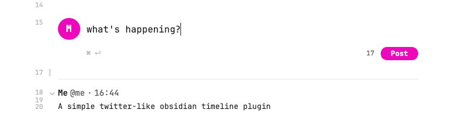

# Daily Timeline

Turn the timestamped entries in your daily notes into a Twitter-style timeline, and post new entries from a built-in composer.



Your notes stay plain Markdown: every entry is just a `### HH:mm` heading followed by text. The plugin only changes how they look and makes adding them faster, so search, links and backlinks keep working, and the notes still read fine without the plugin.

## Features

- **Timeline view**: in Live Preview and Reading view, each `### HH:mm` entry in a daily note is shown as a post with your name, handle and time. Put the cursor on the header line to edit the raw heading.
- **Composer**: add a `daily-timeline` code block to a daily note and it turns into a "What's happening?" box. Press <kbd>⌘/Ctrl</kbd> + <kbd>Enter</kbd> or click **Post** to add an entry stamped with the current time.
- **Post from anywhere**: the **Post to today's timeline** command (and its ribbon icon) opens the composer in a modal and posts to today's daily note.

## Usage

Add the composer to your daily note template wherever you want the timeline to start:

````markdown
```daily-timeline
```
````

New entries are added at the end of that section, before the next `#` or `##` heading:

````markdown
```daily-timeline
```

### 09:35

First thought of the day.

### 10:07

Another one.

## Tasks
````

If a note has no composer block, new entries go after the last existing entry, or at the end of the note.

## Settings

| Setting | Description |
| --- | --- |
| Display name | Name shown on each entry. |
| Handle | Shown as `@handle` next to the name. Leave empty to hide. |
| Avatar | Vault path to an image shown next to the composer. Defaults to your initial. |
| Daily notes folder / Date format | Which notes count as daily notes. Leave empty to use the core **Daily notes** plugin's settings. Notes kept in sub-folders (e.g. `2026/10/2026-10-26.md`) are recognised by file name. |

## Installation

### From Community plugins

Search for **Daily Timeline** in *Settings → Community plugins → Browse*.

### Manually

Download `main.js`, `manifest.json` and `styles.css` from the [latest release](../../releases/latest) into `<vault>/.obsidian/plugins/daily-timeline/`, then enable the plugin.

## Development

```bash
npm install
npm run dev     # watch mode
npm test        # unit tests for the parser
npm run build   # type-check and production build
```

Set `VAULT_PLUGIN_DIR=/path/to/vault/.obsidian/plugins/daily-timeline` to copy every build into a vault.

### Releasing

```bash
npm version patch   # bumps manifest.json and versions.json, creates the tag
git push --follow-tags
```

The GitHub Actions workflow builds the plugin and creates a draft release with `main.js`, `manifest.json` and `styles.css`. Publish the draft when it looks right.

## License

[MIT](LICENSE)
